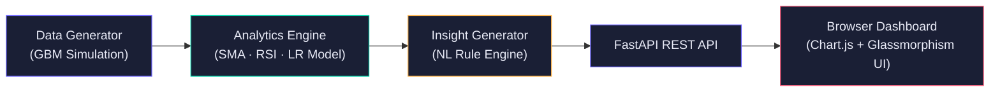

# AI-Based Stock Market Analysis and Prediction System
### AI For Finance — CIA-2 Project Report

---

## Project Summary

> [!IMPORTANT]
> Copy the two paragraphs below directly into your project report submission.

**Paragraph 1 — AI Integration:**
This project integrates Artificial Intelligence into stock market analysis through two complementary approaches. First, a **Scikit-learn Linear Regression** model is trained on 365 days of historical closing price data, using six engineered features: a linear time index, 5-day and 10-day rolling means, 5-day rolling standard deviation, and two lagged close prices. These features capture both the overall price trend and local volatility patterns. The trained model then forecasts the next five trading days' closing prices, providing quantitative forward-looking estimates that go beyond simple historical observation. Second, a **rule-based Natural Language Insight Generator** synthesises the ML forecast with classical technical indicators — the 50-day and 200-day Simple Moving Averages (SMA) and the 14-period Relative Strength Index (RSI) — to produce human-readable, actionable commentary such as *"Golden Cross detected: 50-day SMA above 200-day SMA, signalling bullish momentum. ML model forecasts a 2.8% gain over the next 5 trading days."* This combination of ML prediction and expert-rule synthesis mirrors how modern quantitative trading platforms blend data-driven models with domain knowledge.

**Paragraph 2 — Practical Applications:**
The practical applications of this system extend across multiple dimensions of financial decision-making. Retail investors can use the interactive dashboard to quickly assess whether a stock exhibits bullish or bearish technical signals before committing capital, without needing deep quantitative expertise. The RSI gauge identifies overbought and oversold conditions that historically precede price reversals, while the SMA crossover logic (Golden Cross / Death Cross) provides time-tested trend-confirmation signals. The 5-day ML price forecast equips short-term traders with a data-driven target range, enabling more disciplined entry and exit planning. From an educational standpoint, the system demonstrates how foundational ML techniques — feature engineering, regression modelling, and performance metrics such as R² — can be applied directly to financial time-series data, making it a practical learning tool for finance and data science students. The modular architecture (data generation → analytics engine → insight generator → REST API → browser dashboard) mirrors production-grade fintech systems, reinforcing software engineering best practices alongside the AI methodology.

---

## System Architecture



---

## File Structure

```
StockAI/
├── backend/
│   ├── main.py             ← FastAPI app + route handlers
│   ├── data_generator.py   ← Mock OHLCV data via Geometric Brownian Motion
│   ├── analytics.py        ← SMA, RSI, Linear Regression training & forecast
│   └── insights.py         ← NL insight generator (rule-based synthesis)
├── frontend/
│   └── index.html          ← Single-page glassmorphism dashboard (Chart.js)
└── requirements.txt        ← Python dependencies
```

---

## Setup & Run Instructions

```bash
# 1 — Navigate to project folder
cd c:\Staxx\StockAI

# 2 — Create and activate virtual environment
python -m venv venv
.\venv\Scripts\Activate.ps1        # Windows PowerShell
# source venv/bin/activate          # macOS / Linux

# 3 — Install dependencies
pip install -r requirements.txt

# 4 — Start the server
uvicorn backend.main:app --reload --port 8000

# 5 — Open the dashboard
# Navigate to: http://localhost:8000
```

> [!TIP]
> The API documentation (Swagger UI) is auto-generated by FastAPI at **http://localhost:8000/docs**

---

## API Endpoints

| Method | Endpoint | Description |
|--------|----------|-------------|
| `GET` | `/` | Serves the dashboard HTML |
| `GET` | `/api/tickers` | Returns list of available tickers |
| `GET` | `/api/stock/{ticker}` | Full analysis: OHLCV, SMA, RSI, ML forecast, insights |
| `GET` | `/api/health` | Health check |

---

## Technical Indicators Explained

| Indicator | Formula | Signal |
|-----------|---------|--------|
| **SMA 50** | Mean of last 50 closing prices | Short-term trend direction |
| **SMA 200** | Mean of last 200 closing prices | Long-term trend direction |
| **Golden Cross** | SMA50 > SMA200 | Bullish signal |
| **Death Cross** | SMA50 < SMA200 | Bearish signal |
| **RSI 14** | Momentum oscillator (EWM) | <30 = Oversold, >70 = Overbought |
| **LR Forecast** | Scikit-learn LinearRegression | 5-day price projection |

---

## ML Model Details

| Property | Value |
|----------|-------|
| Algorithm | Linear Regression (`sklearn.linear_model`) |
| Feature scaling | StandardScaler (zero-mean, unit-variance) |
| Features (6) | `[day_index, mean_5, mean_10, std_5, lag_1, lag_2]` |
| Training data | 345 samples (365 days − 20-day lookback) |
| Evaluation metric | R² Score |
| Forecast horizon | 5 trading days (recursive prediction) |

---

## Stock Tickers Available

| Ticker | Company | Volatility |
|--------|---------|-----------|
| `AAPL` | Apple Inc. | Low (σ=1.5%) |
| `TSLA` | Tesla Inc. | High (σ=3.0%) |
| `GOOGL` | Alphabet Inc. | Low (σ=1.2%) |
| `MSFT` | Microsoft Corp. | Low (σ=1.3%) |

> [!NOTE]
> All prices are **simulated** using Geometric Brownian Motion — no real market data or external API keys required.
